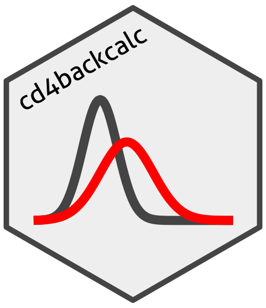
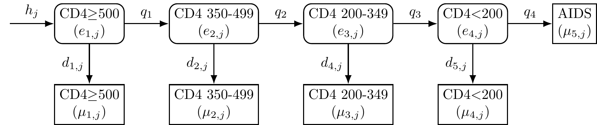
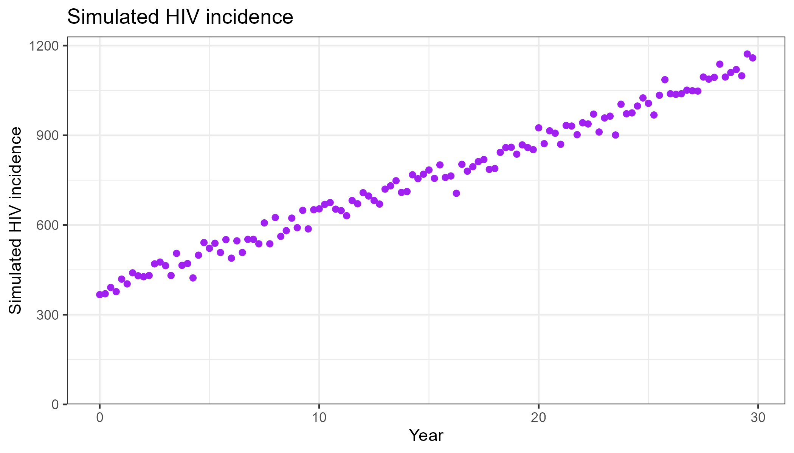
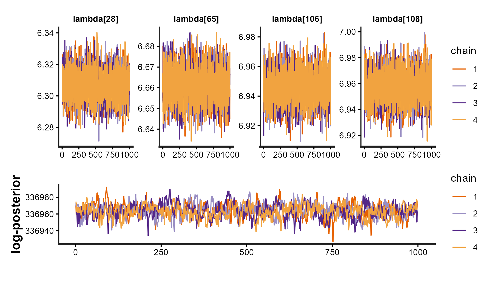
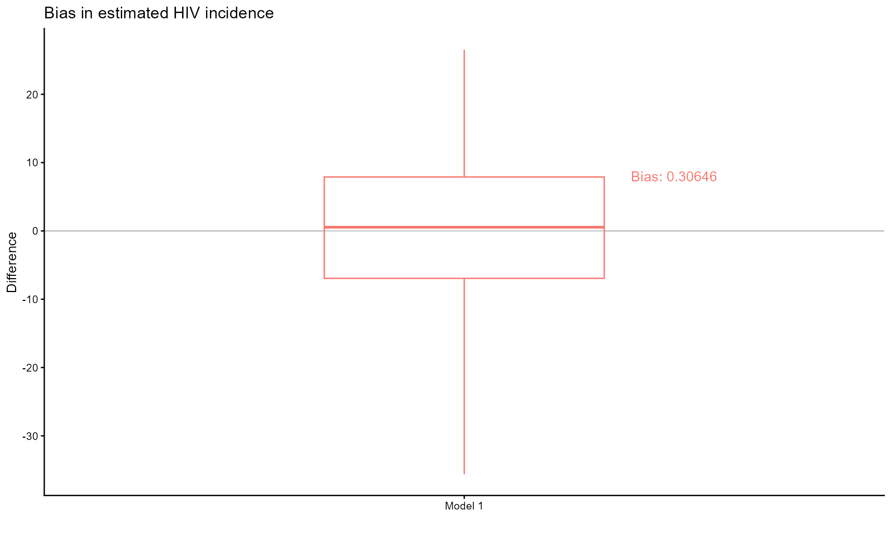
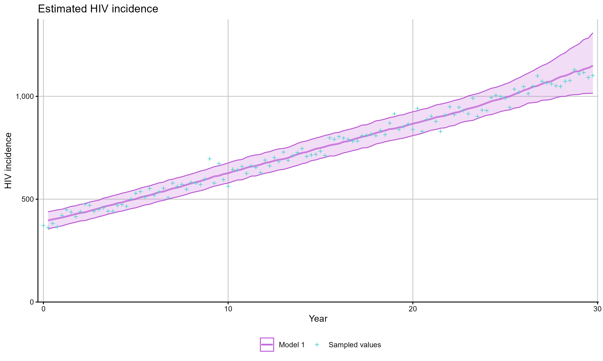

<!-- README.md is generated from README.Rmd. Please edit that file -->

# cd4backcalc 

<!-- badges: start -->

[](https://lifecycle.r-lib.org/articles/stages.html#experimental)
[](https://github.com/pkirwan/cd4backcalc/actions/workflows/R-CMD-check.yaml)
<!-- badges: end -->

The cd4backcalc package implements Bayesian, discrete-time, multi-state models to estimate HIV incidence and undiagnosed HIV prevalence from diagnosis data.

## Description

CD4 back-calculation uses a discrete-time, multi-state Markov model to represent HIV progression until diagnosis. The undiagnosed (latent) states represent decreasing CD4 strata and, when RITA evidence is used, recent HIV acquisition. Model variants can additionally stratify the population by age and country of birth. An illustration of the latent and diagnosed states in a CD4-staged back-calculation model is shown below.

Models are fitted within a Bayesian framework using cmdstanr to estimate HIV incidence, undiagnosed HIV prevalence, and diagnosis probabilities by CD4 state over time.

<div class="figure">


<p class="caption">

Figure: CD4-staged back-calculation model. The model compartments
represent undiagnosed HIV (round boxes) and diagnosed HIV or AIDS
(square boxes); the $h_j$ arrow represents HIV acquired at each time
point ($j$); HIV progression probabilities ($q_i$) vary by CD4 stratum;
HIV diagnosis probabilities ($d_{i,j}$) vary by CD4 stratum and time.
</p>

</div>

## Installation

Before installation you will need to set up a Personal Access Token
(PAT) in Github with “Contents” and “Metadata” permissions for this
repository. See
[here](https://docs.github.com/en/github/authenticating-to-github/creating-a-personal-access-token)
for instructions.

You can then install the development version of cd4backcalc with:

``` r
# install.packages(c("pak", "gitcreds"))
gitcreds::gitcreds_set() # set your PAT in the prompt
pak::pak("pkirwan/cd4backcalc")
```

### System requirements for installation

The cd4backcalc package requires the R package [cmdstanr](https://mc-stan.org/cmdstanr/) (not available on CRAN) and the command-line interface to Stan, [CmdStan](https://mc-stan.org/docs/cmdstan-guide/). See instructions at: [Getting started with CmdStanR](https://mc-stan.org/cmdstanr/articles/cmdstanr.html).

- Windows users will additionally require Rtools to compile the Stan models, see: <https://cran.r-project.org/bin/windows/Rtools/>. 
- MacOS users will require the correct GNU Fortran compiler, see: <https://mac.r-project.org/tools/>.

## Usage

A basic workflow to simulate diagnosis data and fit the CD4-staged
back-calculation model, check convergence and goodness of fit to the
simulated data, and plot model estimates is shown in the example below.

``` r
library(cd4backcalc)

# simulate data under an increasing incidence scenario
sim_diags <- simulate_diagnoses(h_pattern = "increasing")

# visualise simulated data
plot_simulations(sim_diags, quantity = "incidence")
```



``` r
# run back-calculation model on simulated data
# default is 1000 warmup iterations, 1000 sampling iterations, and 4 chains
model_1 <- run_backcalc(sim_diags)

# check convergence
plot_diagnostics(model_1)
```



``` r
# check goodness of fit to simulated values
bias_plot(model_1, quantity = "incidence")
```



``` r
# plot estimates compared to simulated values
plot_estimates(model_1, quantity = "incidence")
```



For real data, pass a Stan-ready list directly to `run_backcalc()` and
supply the matching `migration`, `rita`, and `age` flags for the chosen
model. The input list should contain the diagnosis arrays required for
that model family:

``` r
hiv_list <- run_backcalc(
	real_stan_data,
	migration = TRUE,
	rita = FALSE,
	age = FALSE
)
```

Migration models can incorporate external evidence for the born-abroad to
UK-born UK-acquired incidence ratio (`eta_sd`), detection probability
(`detect_obs_sd`), and migration trend (`gamma_obs_sd`).

If `plot_diagnostics()` or `model_1$fit$cmdstan_diagnose()` indicates
divergent transitions or maximum treedepth warnings, refit with a
larger `adapt_delta` and `max_treedepth`.

## Supported models

The cd4backcalc package includes several models, written in Stan, which
can be used to fit the back-calculation model to real or simulated
diagnosis data under different scenarios:

- Age-independent or age-dependent
- CD4-only or CD4 + RITA data
- With or without migration

The functions in the package are designed to work with all model
variants, with the appropriate model selected based on user-specified
options. The table below shows the options which should be used for each
combination of RITA evidence, migration status, and age structure.

| Model | Age-independent | Age-dependent |
|:---|:--:|:--:|
| CD4 | rita = FALSE, migration = FALSE, age = FALSE | rita = FALSE, migration = FALSE, age = TRUE |
| CD4 + RITA | rita = TRUE, migration = FALSE, age = FALSE | rita = TRUE, migration = FALSE, age = TRUE |
| CD4 + Migration | rita = FALSE, migration = TRUE, age = FALSE | rita = FALSE, migration = TRUE, age = TRUE |
| CD4 + RITA + Migration | rita = TRUE, migration = TRUE, age = FALSE | rita = TRUE, migration = TRUE, age = TRUE |

For the age-independent CD4-only model, `run_backcalc()` also supports
alternative smoothing families via `inf_model` and `diag_model`.

N.B. Due to the increased complexity, fitting times can be substantially
longer when using the age-dependent models. On resource-constrained
systems, “checkpointing” is available to fit these models in stages,
saving and reloading intermediate results, see
[Checkpointing and long runs](https://pkirwan.github.io/cd4backcalc/articles/checkpointing.html)
for details.

## Further resources

See [Getting started](https://pkirwan.github.io/cd4backcalc/articles/cd4backcalc.html)
for the basic workflow,
[Model types](https://pkirwan.github.io/cd4backcalc/articles/model-types.html)
for RITA, migration, and age-dependent models, and
[Analysing results](https://pkirwan.github.io/cd4backcalc/articles/analysing-results.html)
for extracting estimates and comparing fitted models.
