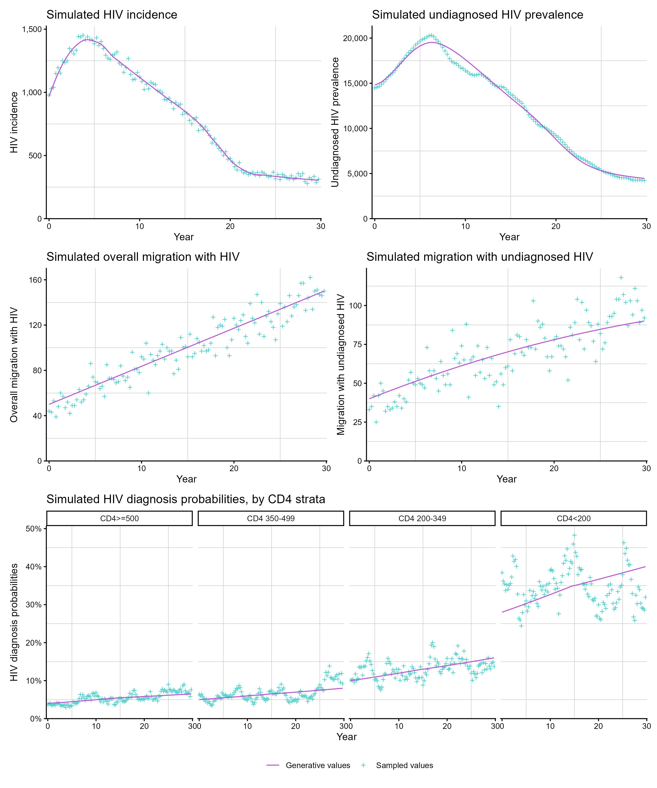
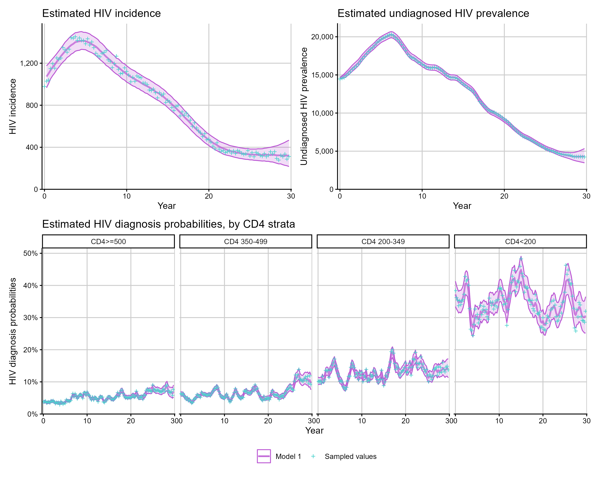
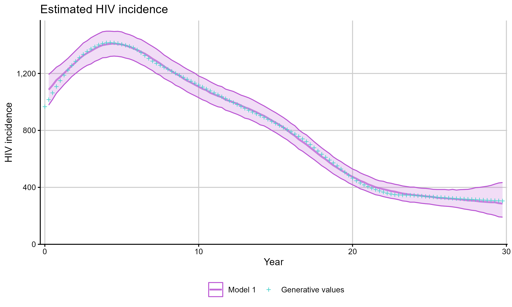
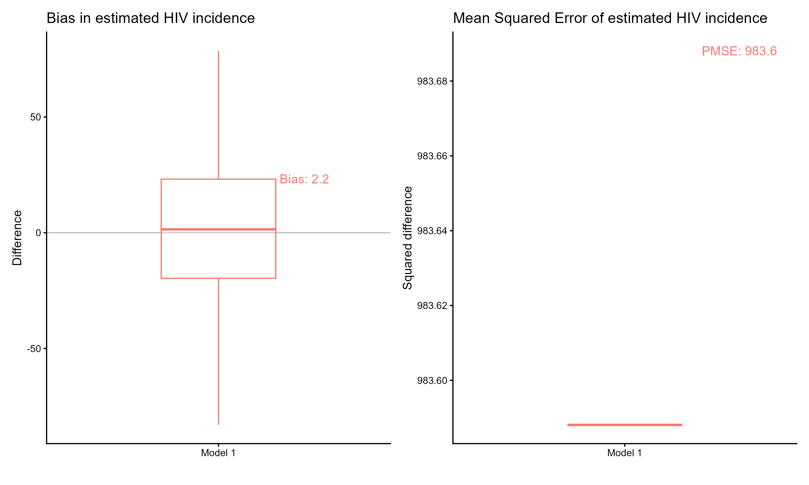
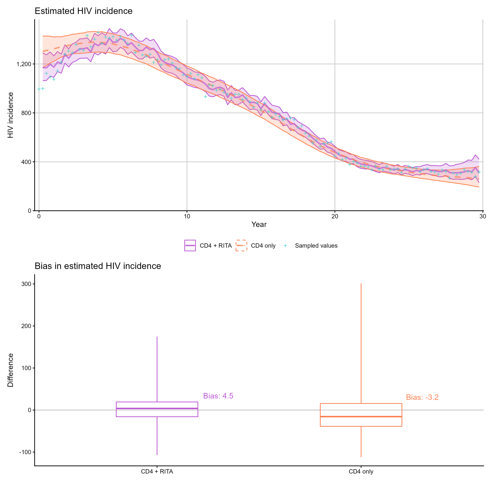
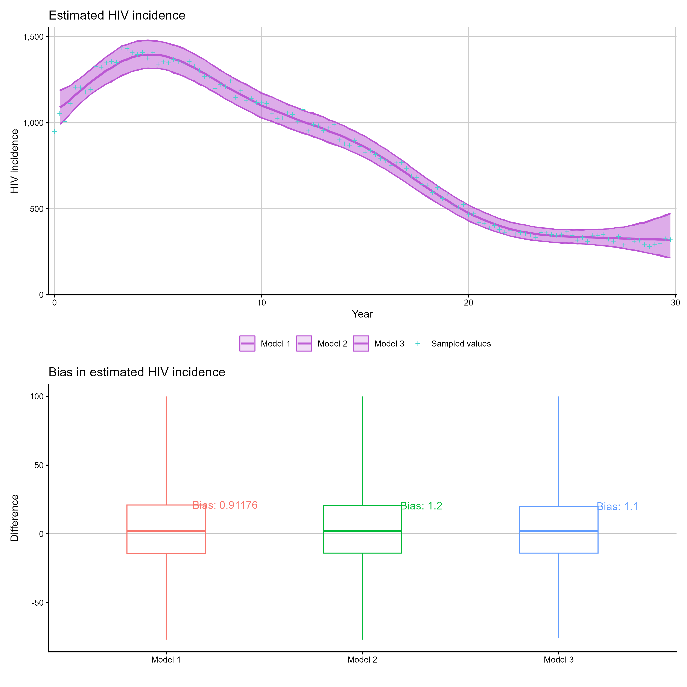
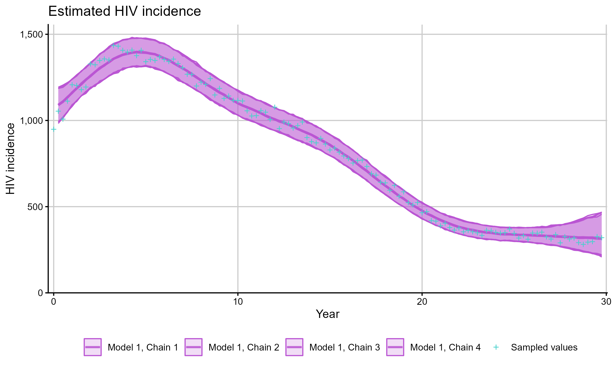

```{r, include = FALSE}
knitr::opts_chunk$set(
  collapse = TRUE,
  comment = "#>"
)
```

This article covers extracting and visualising results from fitted back-calculation models, including the full set of available quantities, model comparison, and working with real data.

```{r setup, eval=FALSE}
library(cd4backcalc)
library(patchwork)
```

## Available quantities

After fitting a model with `run_backcalc()`, several quantities can be plotted or extracted. The available quantities depend on the model type:

**All models:**

| Quantity | Description |
|---------|-------------|
| `"incidence"` | Estimated HIV incidence over time |
| `"undiag_prev"` | Estimated undiagnosed HIV prevalence |
| `"diagnoses"` | Expected vs observed diagnoses |
| `"diag_prob"` | Estimated diagnosis probabilities by CD4 stratum |

**Migration models** (additional):

| Quantity | Description |
|---------|-------------|
| `"all_migration"` | Estimated overall migration with HIV |
| `"undiag_migration"` | Estimated undiagnosed migration |
| `"diag_prob_mig"` | Estimated diagnosis probabilities for migrants by CD4 stratum |
| `"migration_prob"` | Estimated migration probabilities |
| `"ratio_abroad_uk"` | Ratio of UK-acquired incidence among people born abroad to that among UK-born people |
| `"transfers"` | Estimated transfers of care |
| `"transfers_detected"` | Estimated detected transfers of care |
| `"detect_prob"` | Estimated detection probabilities |

**Age-dependent models** (additional):

| Quantity | Description |
|---------|-------------|
| `"incidence_age"` | Incidence stratified by age group |
| `"undiag_prev_age"` | Undiagnosed prevalence by age group |
| `"diagnoses_age"` | Diagnoses by age group |
| `"diag_prob_age"` | Diagnosis probabilities by CD4 stratum and age |

**Age-dependent migration models** (additional):

| Quantity | Description |
|---------|-------------|
| `"undiag_migration_age"` | Undiagnosed migration by age group |
| `"diag_prob_mig_age"` | Migrant diagnosis probabilities by CD4 stratum and age |

## Plotting simulated data

Before fitting, simulated quantities can be inspected with `plot_simulations()`:

```{r plot-sims, eval=FALSE}
sim_diags <- simulate_diagnoses(sim_type = "combo_3", migration = TRUE)

p1 <- plot_simulations(sim_diags, quantity = "incidence")
p2 <- plot_simulations(sim_diags, quantity = "undiag_prev")
p3 <- plot_simulations(sim_diags, quantity = "all_migration")
p4 <- plot_simulations(sim_diags, quantity = "undiag_migration")
p5 <- plot_simulations(sim_diags, quantity = "diag_prob")

(p1 + p2) / (p3 + p4) / p5
```

<div class="figure">

</div>

## Plotting model estimates

`plot_estimates()` shows posterior median and 95% credible intervals. When simulated data is present, the true values are shown for comparison:

```{r plot-ests, eval=FALSE}
hiv_list <- run_backcalc(sim_diags)

p1 <- plot_estimates(hiv_list, quantity = "incidence")
p2 <- plot_estimates(hiv_list, quantity = "undiag_prev")
p3 <- plot_estimates(hiv_list, quantity = "diag_prob")

(p1 + p2) / p3
```

<div class="figure">

</div>

By default, plotting and summary diagnostics compare fitted values with the sampled realisation from the simulation. To compare against the generative expectation from a particular simulation seed instead, set `sim_comparison = "generative"`:

```{r sim-comparison, eval=FALSE}
plot_estimates(
  hiv_list,
  quantity = "incidence",
  sim_comparison = "generative"
)
```

<div class="figure">

</div>

The same argument is available in `bias_plot()` and `mse_plot()`.

## Extracting estimates as data

Use `get_estimates()` to obtain the posterior summary as a tibble for custom analysis:

```{r get-ests, eval=FALSE}
inc_df <- get_estimates(hiv_list, quantity = "incidence")
head(inc_df)
```

```
# A tibble: 6 × 6
   year `2.5%` `50%` `97.5%` group   iteration
  <dbl>  <dbl> <dbl>   <dbl> <chr>       <int>
1  0        0      0      0  Model 1         1
2  0.25   964   1072   1173  Model 1         1
3  0.5   1007.  1106   1204  Model 1         1
4  0.75  1054.  1140   1230. Model 1         1
5  1     1085.  1166   1252. Model 1         1
6  1.25  1115.  1195   1273  Model 1         1
```

## Extracting simulated quantities

Use `extract_simulated_quantity()` to extract the true simulated values for comparison:

```{r extract-sim, eval=FALSE}
sim_inc <- extract_simulated_quantity(sim_diags, quantity = "incidence")
head(sim_inc)
```

```
# A tibble: 6 × 3
  value  year group            
  <dbl> <dbl> <chr>            
1   978  0    Generative values
2  1029  0.25 Generative values
3  1039  0.5  Generative values
4  1149  0.75 Generative values
5  1195  1    Generative values
6  1152  1.25 Generative values
```

Use `extract_real_data()` to extract the observed data used for fitting:

```{r extract-real, eval=FALSE}
obs <- extract_real_data(hiv_list, quantity = "diagnoses")
head(obs)
```

```
# A tibble: 6 × 3
  value  year group          
  <dbl> <dbl> <chr>          
1   715  0    Observed values
2   769  0.25 Observed values
3   771  0.5  Observed values
4   737  0.75 Observed values
5   689  1    Observed values
6   703  1.25 Observed values
```

## Bias and MSE

When fitting to simulated data, `bias_plot()` shows how much the model over- or under-estimates each quantity and `mse_plot()` summarises mean squared error across one or more simulated fits:

```{r bias, eval=FALSE}
p1 <- bias_plot(list(hiv_list), quantity = "incidence")
p2 <- mse_plot(list(hiv_list), quantity = "incidence")

p1 + p2
```

<div class="figure">

</div>

## Comparing two models

`bias_plot()` and `mse_plot()` accept a named list of models for side-by-side comparison:

```{r compare-two, eval=FALSE}
sim_diags <- simulate_diagnoses(sim_type = "combo_3", rita = TRUE)
model_rita <- run_backcalc(sim_diags)

sim_cd4 <- sim_remodel(sim_diags, rita = FALSE)
model_cd4 <- run_backcalc(sim_cd4, rita = FALSE)

p1 <- plot_estimates(
  model_rita,
  hiv_list_2 = model_cd4,
  quantity = "incidence",
  model_1_name = "CD4 + RITA",
  model_2_name = "CD4 only"
)

p2 <- bias_plot(
  list("CD4 + RITA" = model_rita, "CD4 only" = model_cd4),
  quantity = "incidence"
)

p1 / p2
```

<div class="figure">

</div>

## Comparing multiple models

Pass a list of model fits to compare more than two models simultaneously:

```{r compare-list, eval=FALSE}
sim_diags <- simulate_diagnoses(sim_type = "combo_3")
models <- list()
for (i in 1:3) {
  models[[i]] <- run_backcalc(sim_diags, model_seed = 100 + i)
}

p1 <- plot_estimates(models, quantity = "incidence")
p2 <- bias_plot(models, quantity = "incidence")

p1 / p2
```

<div class="figure">

</div>

## Working with real data

When fitting to real (non-simulated) data, plotting and extraction functions still work — the simulated truth overlay is simply omitted. The `stan_data` object should contain the diagnosis arrays required for the chosen model, with matching `migration`, `rita`, and `age` flags supplied to `run_backcalc()`.

```{r real-data, eval=FALSE}
hiv_list <- run_backcalc(
  real_stan_data,
  migration = TRUE,
  rita = TRUE,
  age = FALSE
)

plot_estimates(hiv_list, quantity = "incidence")
plot_estimates(hiv_list, quantity = "diagnoses")
extract_real_data(hiv_list, quantity = "diagnoses")
```

## Per-chain results

For detailed convergence analysis, set `chain_results = TRUE` in `run_backcalc()` to obtain separate posterior summaries for each chain:

```{r chain, eval=FALSE}
hiv_list <- run_backcalc(sim_diags, chain_results = TRUE)
plot_estimates(hiv_list, quantity = "incidence", chain_results = TRUE)
```

<div class="figure">

</div>
