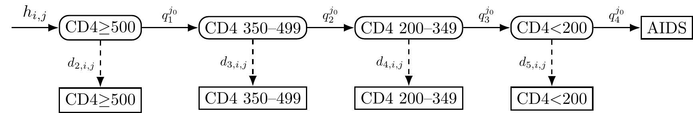

```{r, include = FALSE}
knitr::opts_chunk$set(
  collapse = TRUE,
  comment = "#>"
)
```

The `cd4backcalc` package supports eight model configurations combining CD4-only or CD4 + RITA data, with or without migration, and age-independent or age-dependent structures. This article shows the main arguments used to simulate and fit each family of model, and highlights the outputs available for each combination.

## Supported models

```{r table, echo=FALSE}
grid <- tibble::tribble(
  ~Model, ~`Age-independent`, ~`Age-dependent`,
  "CD4", "`rita=FALSE, migration=FALSE, age=FALSE`", "`rita=FALSE, migration=FALSE, age=TRUE`",
  "CD4 + RITA", "`rita=TRUE, migration=FALSE, age=FALSE`", "`rita=TRUE, migration=FALSE, age=TRUE`",
  "CD4 + Migration", "`rita=FALSE, migration=TRUE, age=FALSE`", "`rita=FALSE, migration=TRUE, age=TRUE`",
  "CD4 + RITA + Migration", "`rita=TRUE, migration=TRUE, age=FALSE`", "`rita=TRUE, migration=TRUE, age=TRUE`"
)
knitr::kable(grid, align = "lcc")
```

The `rita`, `migration`, and `age` flags are passed to both `simulate_diagnoses()` and `run_backcalc()`. When fitting to real data these flags are passed to `run_backcalc()` only.

For the age-independent CD4-only model, `run_backcalc()` also supports alternative smoothing families via `inf_model` and `diag_model` (`1` = spline, `2` = random walk, and for incidence only `3` = GP). Models with migration, RITA, or age structure currently use the spline configuration (`inf_model = 1`, `diag_model = 1`).

## CD4-only model

The CD4-only, age-independent model uses CD4 count at diagnosis and known HIV progression probabilities to estimate incidence and undiagnosed prevalence, see Birrell et al. (2012).

<div class="figure">

<p class="caption">
Figure: CD4-staged back-calculation model. The model compartments
represent undiagnosed HIV (round boxes) and diagnosed HIV or AIDS
(square boxes); the $h_j$ arrow represents HIV acquired at each time
point ($j$); HIV progression probabilities ($q_i$) vary by CD4 stratum;
HIV diagnosis probabilities ($d_{i,j}$) vary by CD4 stratum and time.
</p>
</div>

This model can be fitted with:

```{r cd4-only, eval=FALSE}
library(cd4backcalc)

sim_cd4 <- simulate_diagnoses(h_pattern = "increasing")
fit_cd4 <- run_backcalc(sim_cd4)
plot_estimates(fit_cd4, quantity = "incidence")
```

Alternative smoothing choices are available for the age-independent CD4-only model:

```{r cd4-alt, eval=FALSE}
fit_cd4_rw <- run_backcalc(
  sim_cd4,
  inf_model = 2,
  diag_model = 2
)
```

## Age-dependent models

Age-dependent models stratify HIV incidence and prevalence by age group, see Brizzi et al. (2019).
These models take substantially longer to fit due to the increased number of parameters. 
Checkpointing is available for fitting age-dependent models on resource-constrained systems — see [Checkpointing](checkpointing.html).

<div class="figure">

<p class="caption">
Figure: Age-dependent CD4 back-calculation model with $k$ representing the current age-category and $k_0$ representing the age category at HIV acquisition.
</p>
</div>

```{r age, eval=FALSE}
sim_age <- simulate_diagnoses(age = TRUE, h_pattern = "increasing")
fit_age <- run_backcalc(sim_age)

# age-specific outputs
plot_estimates(fit_age, quantity = "incidence_age")
plot_estimates(fit_age, quantity = "undiag_prev_age")
plot_estimates(fit_age, quantity = "diagnoses_age")

# aggregate estimates are also available
plot_estimates(fit_age, quantity = "incidence")
```

## Adding RITA evidence

Evidence from RITA (Recent Infection Testing Algorithm) testing can provide additional information on recent HIV acquisition, improving the precision of incidence and undiagnosed prevalence estimates, particularly for recent time periods and in populations with a high proportion of recent diagnoses.
Both the age-independent and age-dependent models can be extended to include RITA evidence, see Kirwan et al. (2026).

<div class="figure">

<p class="caption">
Figure: Dual biomarker back-calculation model with recent incidence assay and non-recent incidence assay CD4-staged states. A/w = Acquired within, mo. = months.
</p>
</div>

```{r rita, eval=FALSE}
sim_rita <- simulate_diagnoses(rita = TRUE, h_pattern = "increasing")
fit_rita <- run_backcalc(sim_rita)
plot_estimates(fit_rita, quantity = "incidence")
```

## Migration-adjusted models

The migration-adjusted model uses information on country of birth to distinguish between HIV acquired in the UK and abroad, and estimate trends in migration.
Both the age-independent and age-dependent models can be extended to include migration transitions, as well as models with RITA evidence, see Kirwan et al. (2026).

<div class="figure">

<p class="caption">
Migration-adjusted CD4-staged back-calculation model. Solid lines indicate HIV progression and transition from latent to diagnosed states; dashed line is HIV acquisition among individuals born in the UK, dotted lines are HIV acquisition or migration arrivals among individuals born abroad.
</p>
</div>

```{r migration, eval=FALSE}
sim_mig <- simulate_diagnoses(migration = TRUE, h_pattern = "increasing")
fit_mig <- run_backcalc(sim_mig)

# migration-specific outputs
plot_estimates(fit_mig, quantity = "undiag_migration")
plot_estimates(fit_mig, quantity = "migration_prob")
plot_estimates(fit_mig, quantity = "ratio_abroad_uk")
plot_estimates(fit_mig, quantity = "transfers")
plot_estimates(fit_mig, quantity = "detect_prob")
```

## Combined RITA + migration models

When both recent infection evidence and migration data are available, the same interface extends to the combined model:

```{r rita-migration, eval=FALSE}
sim_rita_mig <- simulate_diagnoses(
  rita = TRUE,
  migration = TRUE,
  h_pattern = "increasing"
)
fit_rita_mig <- run_backcalc(sim_rita_mig)

plot_estimates(fit_rita_mig, quantity = "incidence")
plot_estimates(fit_rita_mig, quantity = "diag_prob_mig")
plot_estimates(fit_rita_mig, quantity = "detect_prob")
```

To fit the corresponding age-dependent model, add `age = TRUE` to both `simulate_diagnoses()` and `run_backcalc()`. Age-specific outputs such as `undiag_migration_age` and `diag_prob_mig_age` are then available.

## Remodelling data

If data was simulated with RITA evidence but you want to fit a CD4-only model (e.g. for comparison), use `sim_remodel()` to restructure the data:

```{r remodel, eval=FALSE}
# simulate with RITA
sim_rita <- simulate_diagnoses(rita = TRUE)

# remodel to CD4-only format
sim_cd4 <- sim_remodel(sim_rita, rita = FALSE)

# fit as CD4-only model
fit_cd4 <- run_backcalc(sim_cd4, rita = FALSE)
```

## Simulation types

For reproducible simulation studies, pre-defined simulation types combine multiple parameter patterns. These are specified via the `sim_type` argument:

```{r sim-types, eval=FALSE}
# combo_3: varying acquisition + step-change migration + varying diagnosis +
#          increasing proportion UK + varying migration probabilities +
#          non-uniform age distribution
sim_c3 <- simulate_diagnoses(sim_type = "combo_3", migration = TRUE)

# combo_4: alternative incidence and migration patterns
sim_c4 <- simulate_diagnoses(sim_type = "combo_4", migration = TRUE)
```

Available simulation types include: `"constant"`, `"h_increasing"`, `"h_varying"`, `"o_increasing"`, `"o_step_change"`, `"d_varying"`, `"p_increasing"`, `"m_differing"`, `"m_varying"`, and `"combo_1"` through `"combo_4"`.

## References

- Birrell PJ, Chadborn TR, Gill ON, Delpech VC, et al. (2012). Estimating trends in incidence, time-to-diagnosis and undiagnosed prevalence using a CD4-based Bayesian back-calculation. _Stat. Commun. Infect. Dis._ 4(1). doi: [10.1515/1948-4690.1055](https://doi.org/10.1515/1948-4690.1055).
- Brizzi F, Birrell PJ, Plummer MT, Kirwan PD, et al. (2019). Extending Bayesian back-calculation to estimate age and time specific HIV incidence. _Lifetime Data Anal._ 25(4), pp.757-780. doi: [10.1007/s10985-019-09465-1](https://doi.org/10.1007/s10985-019-09465-1).
- Kirwan PD, Presanis A, Birrell PJ, et al. (2026). Extending a Bayesian back-calculation model for HIV incidence to include biomarkers of recent acquisition. (in press).
- Kirwan PD, Presanis A, Birrell PJ, et al. (2026). HIV incidence among gay and bisexual men in England, Wales, and Northern Ireland: estimates from a migration-adjusted CD4-staged HIV back-calculation model. (in press).
