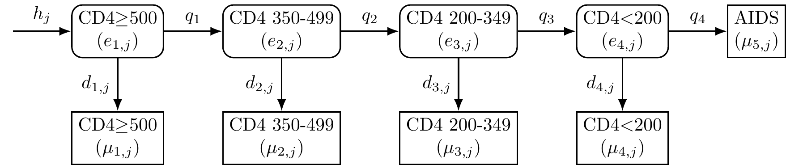
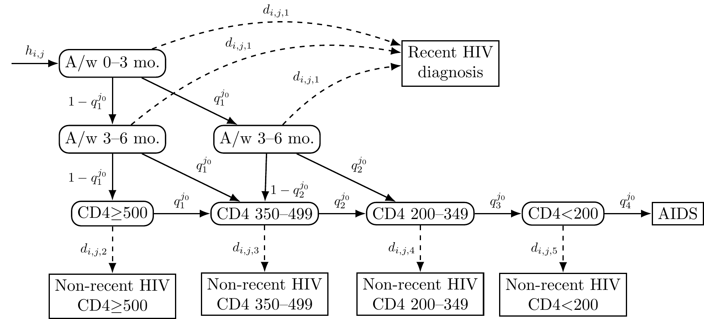
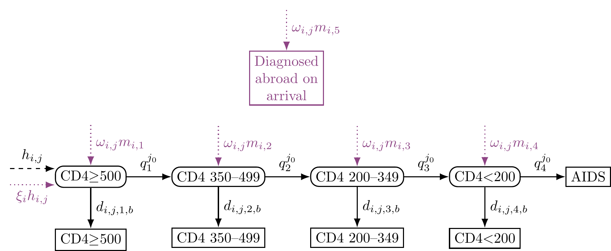

```{r, include = FALSE}
knitr::opts_chunk$set(
  collapse = TRUE,
  comment = "#>"
)
```

The `cd4backcalc` package supports eight model configurations combining CD4-only or CD4 + RITA data, with or without migration, and age-independent or age-dependent structures. This article shows how to simulate data and fit each variant.

## Supported models

```{r table, echo=FALSE}
grid <- tibble::tribble(
  ~Model, ~`Age-independent`, ~`Age-dependent`,
  "CD4", "`rita=FALSE, migration=FALSE, age=FALSE`", "`rita=FALSE, migration=FALSE, age=TRUE`",
  "CD4 + RITA", "`rita=TRUE, migration=FALSE, age=FALSE`", "`rita=TRUE, migration=FALSE, age=TRUE`",
  "CD4 + Migration", "`rita=FALSE, migration=TRUE, age=FALSE`", "`rita=FALSE, migration=TRUE, age=TRUE`",
  "CD4 + RITA + Migration", "`rita=TRUE, migration=TRUE, age=FALSE`", "`rita=TRUE, migration=TRUE, age=TRUE`"
)
knitr::kable(grid, align = "lcc")
```

The `rita`, `migration`, and `age` flags are passed to both `simulate_diagnoses()` and `run_backcalc()`. When fitting to real data these flags are passed to `run_backcalc()` only.

## CD4-only model (basic)

The simplest model uses CD4 count at diagnosis as the only evidence.

<div class="figure">

<p class="caption">
Figure: CD4-staged back-calculation model. The model compartments
represent undiagnosed HIV (round boxes) and diagnosed HIV or AIDS
(square boxes); the $h_j$ arrow represents HIV acquired at each time
point ($j$); HIV progression probabilities ($q_i$) vary by CD4 stratum;
HIV diagnosis probabilities ($d_{i,j}$) vary by CD4 stratum and time.
</p>
</div>

This model can be fitted with:

```{r cd4-only, eval=FALSE}
library(cd4backcalc)

sim_cd4 <- simulate_diagnoses(h_pattern = "increasing")
fit_cd4 <- run_backcalc(sim_cd4)
plot_estimates(fit_cd4, quantity = "incidence")
```

## Adding RITA evidence

RITA (Recent Infection Testing Algorithm) provides additional information on recent infections, improving incidence estimation:

<div class="figure">

<p class="caption">
Figure: Dual biomarker back-calculation model with `recent incidence assay' and `non-recent incidence assay' CD4-staged states. Time, $j$, is indexed by $T$ disjoint, consecutive intervals $(t_{j-1}, t_j], \, j=1,\dots, T$. Rounded boxes indicate latent states, square boxes indicate diagnosed states. Solid lines indicate HIV progression. Dashed lines indicate transition from latent to diagnosed state. A/w = Acquired within, mo. = months.
</p>
</div>

```{r rita, eval=FALSE}
sim_rita <- simulate_diagnoses(rita = TRUE, h_pattern = "increasing")
fit_rita <- run_backcalc(sim_rita)
plot_estimates(fit_rita, quantity = "incidence")
```

## Adding migration

When migration data is available, the model can distinguish between infections acquired in the UK and abroad, and estimate undiagnosed migration.

<div class="figure">

<p class="caption">
CD4-staged back-calculation model including migration transitions. Rounded boxes indicate latent states, square boxes indicate diagnosed states. Solid lines indicate HIV progression and transition from latent to diagnosed state; dashed line is HIV acquisition among individuals born in the UK, dotted lines are HIV acquisition or migration arrivals among individuals born abroad.
</p>
</div>


```{r migration, eval=FALSE}
sim_mig <- simulate_diagnoses(migration = TRUE, h_pattern = "increasing")
fit_mig <- run_backcalc(sim_mig)

# migration-specific outputs
plot_estimates(fit_mig, quantity = "undiag_migration")
plot_estimates(fit_mig, quantity = "migration_prob")
plot_estimates(fit_mig, quantity = "ratio_abroad_uk")
plot_estimates(fit_mig, quantity = "transfers")
plot_estimates(fit_mig, quantity = "detect_prob")
```

## Age-dependent models

Age-dependent models stratify incidence and prevalence by age group. These models are more complex and take substantially longer to fit:

```{r age, eval=FALSE}
sim_age <- simulate_diagnoses(age = TRUE, h_pattern = "increasing")
fit_age <- run_backcalc(sim_age)

# age-specific outputs
plot_estimates(fit_age, quantity = "incidence_age")
plot_estimates(fit_age, quantity = "undiag_prev_age")
plot_estimates(fit_age, quantity = "diagnoses_age")

# aggregate estimates are also available
plot_estimates(fit_age, quantity = "incidence")
```

For age-dependent models on resource-constrained systems, checkpointing is recommended — see [Checkpointing](checkpointing.html).

## Remodelling data

If data was simulated with RITA evidence but you want to fit a CD4-only model (e.g. for comparison), use `sim_remodel()` to restructure the data:

```{r remodel, eval=FALSE}
# simulate with RITA
sim_rita <- simulate_diagnoses(rita = TRUE)

# remodel to CD4-only format
sim_cd4 <- sim_remodel(sim_rita, rita = FALSE)

# fit as CD4-only model
fit_cd4 <- run_backcalc(sim_cd4, rita = FALSE)
```

## Simulation types

For reproducible simulation studies, pre-defined simulation types combine multiple parameter patterns. These are specified via the `sim_type` argument:

```{r sim-types, eval=FALSE}
# combo_3: varying infections + step-change migration + varying diagnosis +
#          increasing proportion UK + varying migration probabilities
sim_c3 <- simulate_diagnoses(sim_type = "combo_3", migration = TRUE)

# combo_4: alternative incidence and migration patterns
sim_c4 <- simulate_diagnoses(sim_type = "combo_4", migration = TRUE)
```

Available simulation types include: `"constant"`, `"h_increasing"`, `"h_varying"`, `"o_increasing"`, `"o_step_change"`, `"d_varying"`, `"p_increasing"`, `"m_differing"`, `"m_varying"`, `"combo_1"` through `"combo_4"`, and `"combo_3_no_migration"`.
