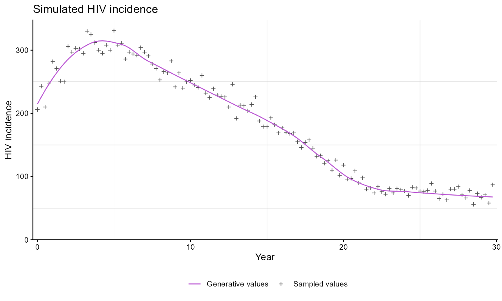
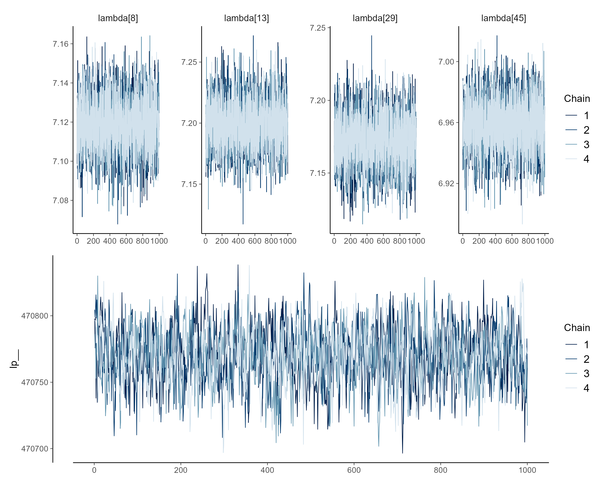
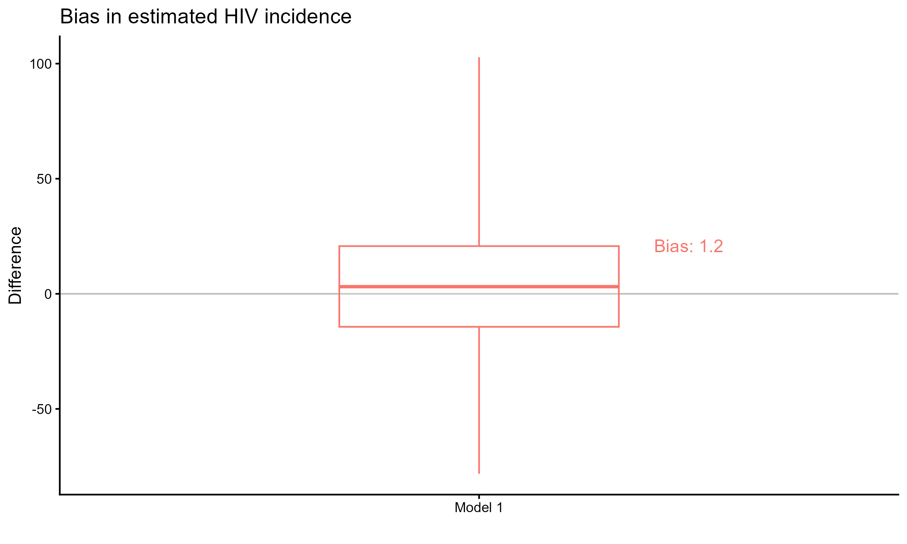
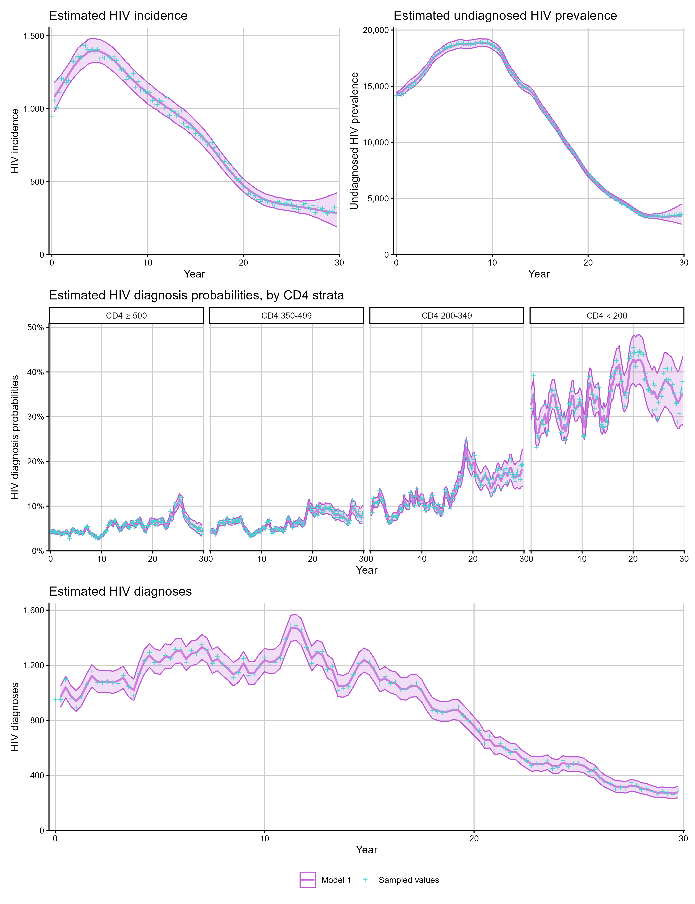
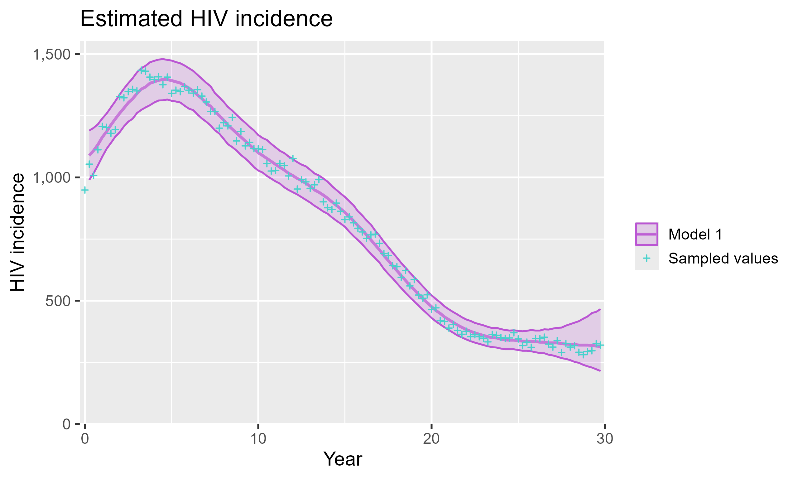

```{r, include = FALSE}
knitr::opts_chunk$set(
  collapse = TRUE,
  comment = "#>"
)
```

This vignette walks through a basic workflow using `cd4backcalc`: simulate HIV diagnosis data, fit a CD4-staged back-calculation model, assess convergence and goodness of fit, and plot the model estimates.

```{r setup, eval=FALSE}
library(cd4backcalc)
library(patchwork)
```

## Simulate data

We first simulate HIV diagnosis data using `simulate_diagnoses()`. This function propagates a specified number of HIV infections through the back-calculation model to generate diagnoses over time. Key arguments control the simulation scenario (`sim_type`), whether to include migration, RITA, and/or age structure, and a seed for reproducibility.

```{r simulate, eval=FALSE}
sim_diags <- simulate_diagnoses(sim_type = "combo_3", sim_seed = 123)
```

If you are working with real data rather than simulated data, you can skip this step and pass a pre-formatted `stan_data` list directly to `run_backcalc()`.

For real data, the input to `run_backcalc()` should be a Stan-ready list containing the diagnosis arrays required for the chosen model. At minimum this includes diagnosis counts (`HIV`, `AIDS`, and `CD4`); migration, RITA, and age-dependent models additionally require the corresponding migration, recency, and age-specific arrays. When fitting real data, pass the matching `migration`, `rita`, and `age` flags explicitly to `run_backcalc()`.

```{r fit-real, eval=FALSE}
hiv_list_real <- run_backcalc(
  real_stan_data,
  migration = TRUE,
  rita = FALSE,
  age = FALSE
)
```

We can visualise the simulated data using `plot_simulations()`:

```{r plot-sim, eval=FALSE}
plot_simulations(sim_diags, quantity = "incidence")
```

<div class="figure">

</div>

## Fit the model

The `run_backcalc()` function fits the CD4-staged back-calculation model using `cmdstanr`. By default, each chain runs 1000 warmup and 1000 sampling iterations across 4 chains.

```{r fit, eval=FALSE}
hiv_list <- run_backcalc(sim_diags)
```

For faster iteration during development, you can reduce the number of iterations and chains:

```{r fit-quick, eval=FALSE}
hiv_list <- run_backcalc(
  sim_diags,
  iter_warmup = 500,
  iter_sampling = 500,
  chains = 2
)
```

## Calibrate initial prevalence

If the fit to the data is poor in the first few quarters, especially with real data, a common issue is that the fixed baseline prevalence inputs (`init_prev`, `init_prev_age`, `init_prev_abroad`, or `init_prev_abroad_age`) are not well calibrated. The `calibrate_init_prev()` function uses the fitted first quarter diagnosis probabilities together with the observed first quarter diagnoses to back-calculate improved initial prevalence values.

```{r calibrate-init, eval=FALSE}
# first fit
hiv_list <- run_backcalc(real_stan_data, migration = TRUE, age = TRUE)

# back-calculate improved baseline prevalence inputs
init_update <- calibrate_init_prev(hiv_list)

# refit using the updated stan_data
hiv_list <- run_backcalc(
  init_update$stan_data,
  migration = TRUE,
  age = TRUE
)
```

By default, age-specific initial prevalence is smoothed over age after summarising the fitted draws. Set `smooth_age = FALSE` to obtain the raw values.

## Assess convergence

Use `plot_diagnostics()` to inspect traceplots and posterior density plots for key parameters:

```{r diagnostics, eval=FALSE}
plot_diagnostics(hiv_list, ntraces = 4)
```

<div class="figure">

</div>

You can also access the underlying `cmdstanr` fit object for additional diagnostics:

```{r cmdstanr-diag, eval=FALSE}
hiv_list$fit$summary()
hiv_list$fit$cmdstan_diagnose()
```

If diagnostics show divergent transitions or maximum treedepth warnings, first try increasing `adapt_delta` and `max_treedepth`. If chains still mix poorly, increase the warmup or sampling iterations and refit:

```{r fit-tuned, eval=FALSE}
hiv_list <- run_backcalc(
  sim_diags,
  adapt_delta = 0.99,
  max_treedepth = 14,
  iter_warmup = 1000,
  iter_sampling = 1500
)
```

## Goodness of fit

When working with simulated data, `bias_plot()` compares the model estimates against the known simulated values:

```{r bias, eval=FALSE}
bias_plot(hiv_list, quantity = "incidence")
```

<div class="figure">

</div>

## Plot estimates

`plot_estimates()` produces plots of the posterior estimates with credible intervals. When simulated data is available, the true values are overlaid for comparison.

```{r estimates, eval=FALSE}
# HIV incidence over time
p1 <- plot_estimates(hiv_list, quantity = "incidence")

# undiagnosed prevalence over time
p2 <- plot_estimates(hiv_list, quantity = "undiag_prev")

# diagnosis probabilities
p3 <- plot_estimates(hiv_list, quantity = "diag_prob")

# expected diagnoses vs observed
p4 <- plot_estimates(hiv_list, quantity = "diagnoses")

(p1 + p2) / p3 / p4
```

<div class="figure">

</div>

All plotting functions return `ggplot2` objects, so they can be further customised:

```{r customise, eval=FALSE}
library(ggplot2)
plot_estimates(hiv_list, quantity = "incidence") +
  theme_gray(14)
```

<div class="figure">

</div>

## Next steps

- See [Model types](https://pkirwan.github.io/cd4backcalc/articles/model-types.html) for fitting models with RITA evidence, migration, and age structure.
- See [Analysing results](https://pkirwan.github.io/cd4backcalc/articles/analysing-results.html) for extracting estimates, comparing models, and the full set of available quantities.
- See [Checkpointing](https://pkirwan.github.io/cd4backcalc/articles/checkpointing.html) for fitting large models in stages on resource-constrained systems.
